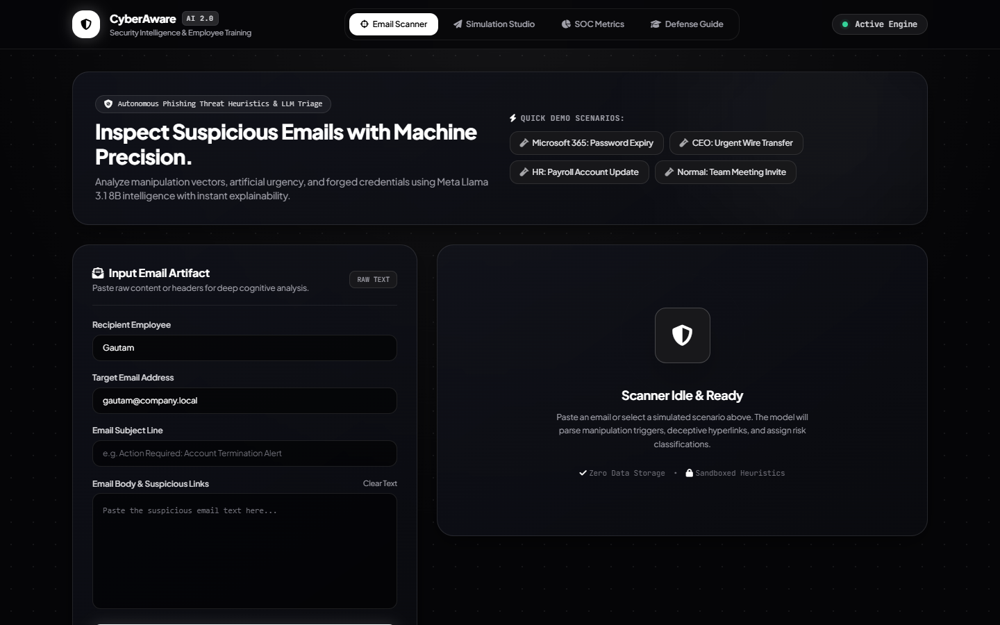
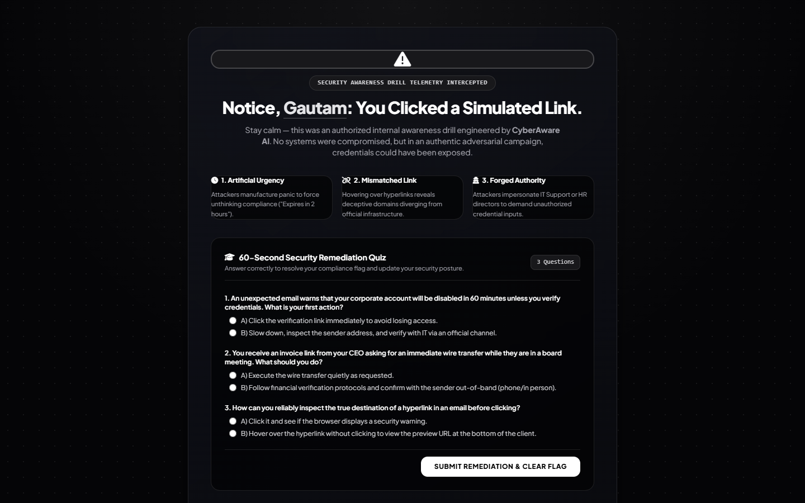
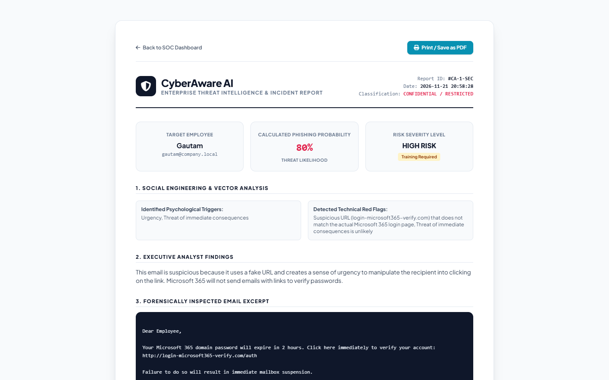

# 🛡️ CyberAware AI — Phishing Detection & Security Awareness Platform

> A working AI-powered security awareness tool built to help organizations detect phishing emails, run employee simulations, and track security training — all from a clean SOC-style dashboard.

**Built by:** Gautam  
**Stack:** Python · Flask · SQLite · Chart.js · Tailwind CSS · OpenRouter AI (Llama 3.1)

---

## 🎯 What This Project Does

Phishing is the #1 entry point for cyberattacks. This tool helps organizations:

1. **Scan suspicious emails** using AI to detect manipulation tactics
2. **Run phishing simulations** — send fake phishing links to employees
3. **Track who clicked** on simulated phishing links
4. **Train employees** who fell for it, via a micro quiz
5. **Monitor security posture** via a live dashboard with charts

---

## ✨ Features

### 🤖 AI Phishing Email Analyzer
- Paste any suspicious email and get an instant risk assessment
- **Risk Level:** HIGH / MEDIUM / LOW with probability score (0–100%)
- Detects manipulation tactics: urgency tricks, fake authority, money bait, dangerous links
- Explains *why* the email is suspicious in plain language
- 4 built-in demo emails (1-click load for presentations)
- Uses Llama 3.1 AI via OpenRouter API; falls back to rule-based detection if offline

### 🎣 Phishing Simulation Module
- Generate `/click/<employee>` tracking links per employee
- When someone clicks → recorded in database automatically
- Shows a **teachable moment** landing page (not a scary error — an educational moment!)
- 3-question remediation quiz → marks employee as **Trained** on completion

### 📊 SOC Dashboard
- 4 live stat cards: Total Scans, High Risk Emails, Click-Through Rate, Training Compliance
- **Risk doughnut chart:** breakdown of High/Medium/Low risk scans
- **Department bar chart:** which teams are most vulnerable
- Employee directory with real-time security posture (Safe / Clicked / Trained)

### 📋 Incident Report
- Printable CISO-style report for any scan: `/report/<scan_id>`
- Shows full analysis with risk level, red flags, training recommendation

### 👥 Employee Management
- Add employees from the dashboard
- Syncs with legacy `employees.txt` and `clicked_employees.txt` files

---

## 🚀 Quick Start

### 1. Clone the repo
```bash
git clone https://github.com/YourUsername/CyberAware-AI.git
cd CyberAware-AI
```

### 2. Install dependencies
```bash
pip install -r requirements.txt
```

### 3. Set up environment variables
```bash
cp .env.example .env
# Edit .env and add your OpenRouter API key
```

Get a free API key at [openrouter.ai](https://openrouter.ai)

### 4. Run the app
```bash
python app.py
```

Or on Windows, just double-click **`run.bat`**

### 5. Open in browser
```
http://127.0.0.1:5000
```

---

## 📁 Project Structure

```
CyberAware-AI/
├── app.py                  # Flask routes & main application
├── ai_engine.py            # Phishing detection (AI + rule-based fallback)
├── database.py             # SQLite database operations
├── templates/
│   ├── index.html          # Main SOC dashboard UI
│   ├── simulation_landing.html  # Teachable moment + remediation quiz
│   └── report.html         # Printable incident report
├── requirements.txt
├── .env.example
├── .gitignore
├── run.bat                 # 1-click Windows launcher
└── README.md
```

---

## 🛠️ Tech Stack

| Layer | Technology |
|---|---|
| Backend | Python 3.12 + Flask |
| Database | SQLite (zero setup) |
| AI Engine | Llama 3.1 8B via OpenRouter API |
| Fallback | Custom rule-based heuristics engine |
| Frontend | HTML + Tailwind CSS (CDN) + Chart.js |
| Charts | Chart.js (Doughnut + Bar) |

---

## 🔒 How the AI Engine Works

The phishing detection uses a **two-layer approach**:

**Layer 1 — Rule-Based Heuristics (always runs):**
- Checks for urgency keywords ("expires today", "account suspended")
- Detects financial manipulation ("wire transfer", "gift card", "payroll update")
- Flags fake authority claims ("IT support", "verify your account")
- Finds suspicious URLs using regex pattern matching

**Layer 2 — AI Analysis (runs when API key is set):**
- Sends email to Llama 3.1 (8B) via OpenRouter
- Returns structured JSON with probability, risk level, tactics, reason, safety tips
- Falls back to Layer 1 if API is unavailable or rate-limited

---

## 🎓 Key Concepts Demonstrated

This project demonstrates practical understanding of:

- **Social Engineering** — how phishing emails manipulate human psychology
- **Threat Detection** — rule-based vs. AI-based email analysis
- **Security Awareness Training** — the teachable moment approach
- **Click-Through Rate tracking** — measuring phishing simulation effectiveness
- **SOC (Security Operations Center) dashboards** — real-time security metrics
- **Risk Scoring** — classifying threats as LOW/MEDIUM/HIGH

---

## ⚙️ Configuration

| Variable | Description | Default |
|---|---|---|
| `OPENROUTER_API_KEY` | Your OpenRouter API key | Required for AI mode |
| `SECRET_KEY` | Flask session secret | Auto-generated |
| `PORT` | Port to run on | 5000 |

---

## 📸 Screenshots

### 1. Luxury Black & White Threat Inspector


### 2. Behavioral Teachable Moment & Remediation Micro-Quiz


### 3. Formal Executive Incident Audit Report


---

## 🤝 Contributing

This is a portfolio/academic project. Feel free to fork and extend it!

---

## 📄 License

MIT License — use it, fork it, learn from it.

---

*CyberAware AI — Making phishing education accessible, one scan at a time.*
